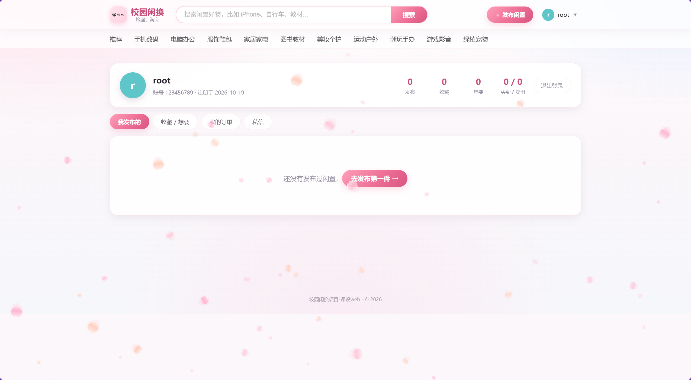

# 校园闲换 · 校园二手交易平台

> 一个面向校园场景的二手闲置交易平台 —— Flask + MySQL + 原生 JavaScript
>
> 课程设计（Web 开发）项目，从需求文档迭代到可运行的完整应用。


**当前版本：v2.1.0** · 2026-10-19

无需预先建库、无需预置账号：配置好 `.env` 后 `python app.py` 一条命令即可启动，
数据库与全部数据表会在首次启动时自动创建，账号请在网页上自行注册。

## 目录

- [功能特性](#功能特性)
- [技术栈](#技术栈)
- [界面预览](#界面预览)
- [快速开始](#快速开始)
- [数据初始化](#数据初始化)
- [项目结构](#项目结构)
- [API 一览](#api-一览)
- [数据库设计](#数据库设计)
- [配置项](#配置项)
- [安全说明](#安全说明)
- [常见问题](#常见问题)
- [已知限制](#已知限制)
- [版本迭代](#版本迭代)
- [License](#license)

## 功能特性

### 用户

- **注册 / 登录 / 退出** —— 图形验证码防机器人，Flask Session 登录态，登录后 7 天免重复登录
- **个人中心** —— 修改昵称、上传头像、修改密码（登录账号不可改）
- **信用分** —— 用户信用分体系，初始 100

### 商品

- **浏览与搜索** —— 首页商品瀑布流、关键词搜索、分类筛选
- **分类动态下发** —— 10 个校园分类由数据库 `categories` 表提供，前端不再写死
- **发布闲置** —— 标题、分类、价格、原价、成色、描述、交易地点、多图上传（单次请求上限 30MB）
- **详情页** —— 多图 + 缩略图切换、卖家信息、浏览量统计
- **状态流转** —— 在售 / 已售出 / 已下架，卖家可切换、可删除自己的商品

### 交易

- **收藏 / 想要** —— 落库存储，联合唯一索引杜绝重复累加
- **下单** —— 详情页拍下即生成订单，订单状态：待付款 / 已付款 / 已完成 / 已取消
- **站内私信** —— 按商品维度的买家卖家对话，未读计数与会话列表
- **订单评价** —— 订单完成后买家可 1-5 星评分 + 文字评价，商品详情页展示平均分与评价列表

### 工程

- **请求限流** —— Flask-Limiter，登录/注册/上传/私信分别收紧，登录用户按用户 ID 限流（避免校园 NAT 共用出口 IP 被连带误伤）
- **连接池** —— DBUtils `PooledDB`，上限 20、池满阻塞等待、取用前 ping 探活
- **密钥外置** —— 优先读环境变量，未配置时本地生成并持久化，不把密钥写进代码
- **统一异常处理** —— 未捕获异常只写日志，不向前端回显堆栈
- **响应式布局** —— 窄屏自动切换移动端布局

## 技术栈

| 层次 | 选型 |
| --- | --- |
| 后端框架 | Python 3.10+ / Flask 3 |
| 数据库 | MySQL 8.0（`utf8mb4`） |
| 数据库访问 | PyMySQL + DBUtils 连接池 |
| 认证 | Flask Session + PBKDF2-SHA256 密码哈希 |
| 限流 | Flask-Limiter |
| 验证码 | Pillow 动态生成 |
| 前端 | 原生 HTML / CSS / JavaScript（无框架、无构建步骤） |
| 跨域 | flask-cors |

## 界面预览

> 截图存放于 `docs/screenshots/`。

| 首页 | 商品详情 |
| --- | --- |
|  |  |

| 登录注册 | 个人中心 |
| --- | --- |
|  |  |

## 快速开始

### 环境要求

- Python **3.10+**
- MySQL **8.0+**（5.7 未测试）

### 1. 获取代码

```bash
git clone https://github.com/MZYQ-LH/secondhand-trade-platform.git
cd secondhand-trade-platform
```

### 2. 安装依赖

```bash
python -m pip install -r requirements.txt
```

### 3. 配置数据库连接

复制 `.env.example` 为 `.env`，填入你自己的 MySQL 账号密码：

```ini
XQ_DB_HOST=127.0.0.1
XQ_DB_PORT=3306
XQ_DB_USER=root
XQ_DB_PASSWORD=你的密码
XQ_DB_NAME=xq_secondhand
```

> `.env` 已被 `.gitignore` 忽略，不会被提交。
> 数据库名只能用字母、数字、下划线；库不存在时会自动创建。

### 4. 启动

```bash
python app.py
```

首次启动会自动完成：建库 → 建表 → 写分类 → 补索引。
浏览器打开 <http://127.0.0.1:5000/index.html>，点「注册」创建你的第一个账号。

## 数据初始化

本项目**不预置任何账号、商品或演示数据**，登录页也不提供任何预设账号提示：

- 账号：在网页「注册」页自行创建
- 分类：程序自动写入 10 个校园分类
- 商品：由你自行发布

`python app.py` 启动后即是完整可用的系统，无需再执行任何初始化脚本。

## 项目结构

```
secondhand-trade-platform/
├── app.py                    # Flask 后端：全部 API、鉴权、限流、静态托管
├── config.py                 # 统一配置：加载 .env，导出数据库/服务配置
├── db_migrate.py             # 建库建表 + 分类 + 历史数据迁移（可单独执行）
├── db_indexes.py             # 热查询索引补齐（可单独执行）
├── db_reviews.py             # 只补「评价表」的增量迁移（可单独执行）
├── requirements.txt
├── .env.example              # 环境变量模板（复制为 .env）
├── .gitignore
├── index.html                # 首页
├── login.html                # 登录 / 注册
├── detail.html               # 商品详情
├── publish.html              # 发布闲置
├── profile.html              # 个人中心
├── logo.svg
├── css/
│   ├── style.css             # 基础样式
│   ├── pages.css             # 页面级样式
│   └── theme.css             # 主题与配色变量
├── js/
│   ├── data.js               # API 封装 / 登录态 / 公共组件
│   ├── index.js              # 首页逻辑
│   ├── detail.js             # 详情页逻辑
│   ├── login.js              # 登录注册逻辑
│   ├── publish.js            # 发布逻辑
│   ├── profile.js            # 个人中心逻辑
│   └── petals.js             # 樱花飘落背景（纯装饰，无依赖）
├── images/                   # 上传图片目录（gitignore，仅保留 .gitkeep）
└── docs/
    └── screenshots/          # README 用截图（可选）
```

## API 一览

所有业务接口以 `/api` 为前缀，返回 JSON。写操作均需登录（依赖 Session Cookie）。

### 认证与用户

| 方法 | 路径 | 说明 |
| --- | --- | --- |
| GET | `/api/captcha` | 获取图形验证码 |
| POST | `/api/register` | 注册 |
| POST | `/api/login` | 登录 |
| POST | `/api/logout` | 退出 |
| GET | `/api/me` | 当前登录用户 |
| GET | `/api/users/<uid>` | 公开用户资料 |
| POST | `/api/me/profile` | 修改昵称 / 头像 |
| POST | `/api/me/password` | 修改密码 |

### 商品

| 方法 | 路径 | 说明 |
| --- | --- | --- |
| GET | `/api/categories` | 分类列表 |
| GET | `/api/products` | 商品列表（搜索 / 分类 / 排序 / 分页，排序支持 `new`、`price_asc`、`price_desc`、`hot`） |
| GET | `/api/products/<pid>` | 商品详情 |
| POST | `/api/products/<pid>/view` | 浏览量 +1 |
| POST | `/api/products` | 发布商品 |
| POST | `/api/products/<pid>/status` | 切换在售 / 已售出 / 已下架 |
| DELETE | `/api/products/<pid>` | 删除自己的商品 |
| POST | `/api/upload` | 上传图片 |

### 收藏与订单

| 方法 | 路径 | 说明 |
| --- | --- | --- |
| POST | `/api/products/<pid>/favorite` | 收藏 / 取消收藏 |
| POST | `/api/products/<pid>/want` | 想要 / 取消想要 |
| GET | `/api/me/collections` | 我的收藏 |
| GET | `/api/me/products` | 我发布的商品 |
| POST | `/api/orders` | 下单 |
| GET | `/api/orders` | 我买到 / 我卖出的订单 |
| POST | `/api/orders/<oid>/status` | 更新订单状态 |

### 评价与私信

| 方法 | 路径 | 说明 |
| --- | --- | --- |
| POST | `/api/orders/<oid>/review` | 提交评价（1-5 星） |
| GET | `/api/products/<pid>/reviews` | 商品评价列表与平均分 |
| GET | `/api/me/reviews` | 我发出的 / 收到的评价 |
| GET | `/api/messages` | 与某人的对话 |
| POST | `/api/messages` | 发送私信 |
| GET | `/api/messages/conversations` | 会话列表 |
| GET | `/api/messages/unread` | 未读数量 |

## 数据库设计

共 8 张表，均由 `db_migrate.py` 幂等创建：

| 表 | 说明 |
| --- | --- |
| `users` | 用户（账号、PBKDF2 密码哈希、昵称、头像、信用分） |
| `categories` | 商品分类（10 个校园分类，接口下发） |
| `products` | 商品主表（价格、成色、描述、状态、浏览量、想要数） |
| `product_images` | 商品图片，与 `products` 一对多 |
| `favorites` | 收藏 / 想要（`type` 区分，联合唯一索引） |
| `orders` | 订单（订单号、买家、卖家、金额、状态） |
| `messages` | 站内私信（按商品维度的买卖双方对话） |
| `reviews` | 订单评价（1-5 星 + 文字） |

`db_reviews.py` 用于「只想补评价功能」的增量场景，单独创建 `reviews` 表。

## 配置项

通过环境变量或 `.env` 注入，优先级：**真实环境变量 > `.env` > `config.py` 默认值**。
完整模板见 [`.env.example`](.env.example)。

| 变量 | 默认值 | 说明 |
| --- | --- | --- |
| `XQ_DB_HOST` | `127.0.0.1` | MySQL 地址 |
| `XQ_DB_PORT` | `3306` | MySQL 端口 |
| `XQ_DB_USER` | `root` | MySQL 用户 |
| `XQ_DB_PASSWORD` | 空 | MySQL 密码 |
| `XQ_DB_NAME` | `xq_secondhand` | 数据库名（不存在会自动创建） |
| `XQ_DB_POOL_SIZE` | `20` | 连接池上限 |
| `XQ_HOST` | `127.0.0.1` | 监听地址，`0.0.0.0` 允许局域网访问 |
| `XQ_PORT` | `5000` | 监听端口 |
| `FLASK_DEBUG` | `0` | 调试模式，生产务必为 0 |
| `XQ_SECRET_KEY` | 空 | 会话密钥，留空则自动生成 `instance_secret.key` |

## 安全说明

项目已做的基础防护：

- 密码 **PBKDF2-SHA256** 加盐哈希存储，不存明文
- 会话密钥外置（环境变量优先），`instance_secret.key` 已在 `.gitignore` 中
- 写接口全部要求登录
- 未捕获异常只写日志，不回显堆栈给前端
- 登录 / 注册 / 上传 / 私信分别限流
- 上传文件按扩展名白名单校验

**部署到公网前还需要处理：**

- 默认监听 `127.0.0.1`；若要开放访问请显式设 `XQ_HOST=0.0.0.0`，并置于反向代理与 HTTPS 之后
- `CORS(app, supports_credentials=True)` 目前对任意来源放行，公网部署应收窄 `origins`
- 默认数据库账号 `root/root` 仅适合本地开发，生产请建专用最小权限账号
- Flask 自带开发服务器不适合公网，请换用 gunicorn / waitress 等 WSGI 服务器

## 常见问题

**启动时报连不上 MySQL / `Unknown database`**

检查 `.env` 里的 `XQ_DB_*` 是否正确，并确认 MySQL 服务已启动。数据库不存在时会自动创建，但所用账号需要有建库权限。

**端口 5000 被占用**

在 `.env` 中把 `XQ_PORT` 改成其它端口，或先结束占用该端口的进程。

**首页是空的，一件商品都没有**

本项目不预置商品。请先注册账号，再通过「发布闲置」发布商品。

**上传的图片重启后还在吗**

文件保存在 `images/` 目录。该目录已被 `.gitignore` 忽略，但文件仍在本机；换机器或手动删除目录后图片会丢失（数据库里只剩路径）。

**改了代码不生效**

默认关闭自动重载。把 `.env` 里的 `FLASK_DEBUG` 设为 `1` 即可开启 debug 与热重载。

**数据库想换个名字 / 换台机器**

只改 `.env` 里的 `XQ_DB_NAME` 即可，下次启动会自动建新库并初始化好全部表结构；旧库不会被动。

## 已知限制

- 前端为原生 JS，未引入框架，页面状态管理靠手写，大型化会吃力
- 未接入支付，订单状态由买卖双方手动流转
- 未做图片压缩，上传大图会占用较多磁盘
- 无自动化测试

## 版本迭代

### v2.1.0 — 彻底移除预设数据（2026-10-19）

**变更内容**

- **删除 `seed_demo.py`**：项目不再提供任何演示数据脚本，部署后即是干净空库
- **登录页移除演示账号区块**：去掉「点击一键填入」的账号提示，以及对应的 JS 事件与 CSS 样式
- 系统中不再存在任何预置账号，全部通过「注册」页自行创建
- **修复端口适配**：前端原先把 API 地址写死为 `5000`，改 `XQ_PORT` 后会提示「验证码加载失败」。现在只要由 Flask 托管就一律使用同源地址，改端口、换 IP 都不需要改代码

**为什么这样改**

早期为了方便演示内置了演示账号与示例商品，但带来两个问题：
一是演示账号的弱密码容易被误认为是系统默认登录入口；
二是示例数据会混入真实使用的数据库，清理起来麻烦。
v2.1.0 起彻底移除这部分，保持代码与数据干净。

### v2.0.0 — 开源版本（2026-10-19）

在 v1 基础上新增「订单评价」完整链路（`reviews` 表，共 8 张表），并完成开源化整理。

**新增功能**

- 订单评价：订单完成后买家可 1-5 星评分 + 文字评价，一单一评
- 商品详情页展示平均分与评价列表
- 个人中心可查看「我发出的 / 我收到的」评价

**开源化改造**

- 新增统一配置入口 `config.py`，支持 `.env`（优先级：真实环境变量 > `.env` > 代码默认值）
- 启动自动初始化：`python app.py` 自动建库、建表、写分类、补索引，全部幂等
- 不预置任何账号与商品；`seed_demo.py` 改为完全可选的演示数据脚本，缺图时自动生成占位图
- 补充 `README.md`、`LICENSE`（MIT）、`.gitignore`、`.env.example`
- 清理硬编码数据库凭据与本机绝对路径；默认监听地址改为 `127.0.0.1`
- 上传图片目录 `images/` 不再纳入版本控制
- 移除 Windows 启动脚本，统一使用 `python app.py` 启动

### v1.0.0 — 基础版本

完成 7 张数据表的迁移、注册登录（图形验证码）、商品发布与多图、收藏 / 想要、
下单与订单状态流转、站内私信、个人中心等核心功能。

## License

[MIT](LICENSE)
